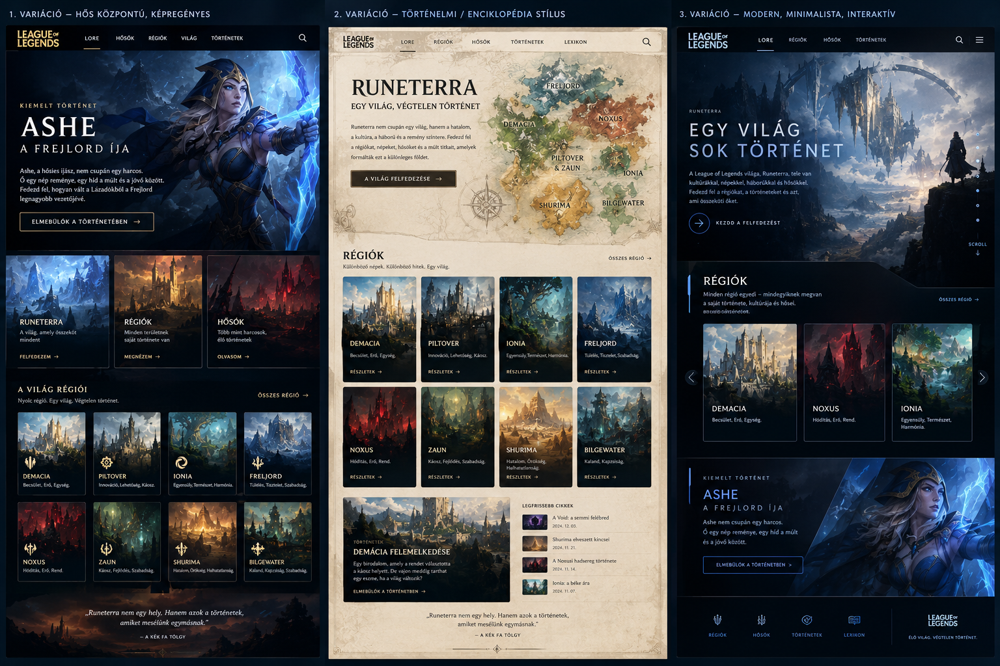

# Runeterra – League of Legends történetei

Ez a projekt a League of Legends történeteiről másnéven lorejáról van meg írva

## Látványkép

## A weboldal részei

### Kezdőlap

- **Kezdete:** rövid ismertető Runeterra létrejöttéről.
- **Régiók:** kártyák vezetnek a régiók részletes bemutatóira.
- **Karakterek:** lapozható carousel Viego, Garen és Darius képeivel és rövid leírásaival.

### Régiók

A kezdőlapról az alábbi régiók külön oldalai nyithatók meg:

- **Demacia** – a becsület és igazság birodalma, valamint a mágiához fűződő viszonya.
- **Noxus** – terjeszkedő birodalom, ahol az erő és az érdem emelkedési lehetőséget ad.
- **Bilgewater** – kalózváros veszélyes tengeri élővilággal és Nagakabourosszal.
- **Shadow Isles / Blessed Isles** – a korábban Blessed Isles néven ismert szigetek története és átka.

Az egyes oldalakról a **Vissza** hivatkozással lehet a kezdőlapra jutni.

### Karakterek

A karaktereket egy bootstrap v5.0 carousel-el oldottam meg

## Felhasznált eszközök

A bootstrap az adott kártyáknál meg a carouselnél, Html maga a weboldal és css a weboldal megformázásával.

## Projekt felépítése

Úgy terveztem meg hogy legyen egy főoldal melyben a kezdetét láthassuk és az opciókat a külön régiókhoz és pár karakter bemutatását. A régiókat külön html és css-el kötöttem össze hogy mindegyik meg legyen akülön kialakítása.

## Forrás
- Szöveg: Saját megfogalmazás és youtube
- Információk: [League of Legends Universe](https://universe.leagueoflegends.com/hu_HU/).
- A weboldalon felhasznált képek: [Pics mappa](Pics/).
- Az oldalam linkje: [Projekt](https://kien6796.github.io/Projekt/)
